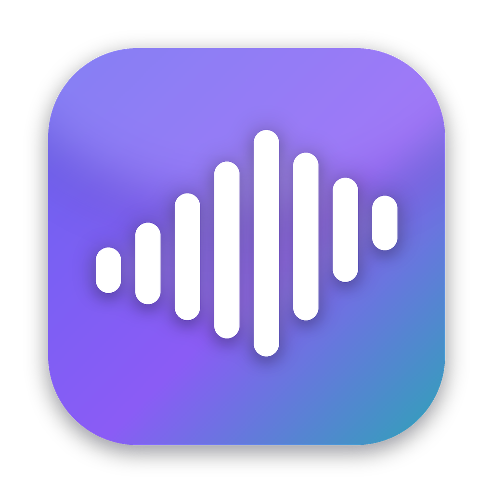

<p align="center"></p>

# Plume

Record your **microphone and system audio** on macOS whenever you want — meetings, calls, lectures — and optionally get a transcript. Everything happens on your Mac: recordings, transcripts and speaker voice profiles are stored locally and **never sent to any cloud**.

Built with SwiftUI and Apple's ScreenCaptureKit. No virtual audio drivers needed.

## Features

- Record system audio + microphone into a single M4A or WAV file
- Menu bar controls and a floating recording pill
- Recordings library with playback, rename and delete
- On-device transcription (Apple Speech framework), optionally automatic when a recording stops
- Speaker labels in transcripts, with voices remembered across recordings (on-device)
- Themes: system / light / dark

## Privacy

- Audio, transcripts and speaker profiles stay in your save folder (default `~/Documents/Plume`) and app preferences
- Transcription and speaker identification run entirely on-device; Plume makes no network calls for them
- Speech language assets are managed by macOS and downloaded by the system only when you pick a language

## Requirements

- macOS **26.0+**, Apple Silicon (arm64)
- **Xcode 26+** (full app, not only Command Line Tools)
- [XcodeGen](https://github.com/yonaskolb/XcodeGen): `brew install xcodegen`

## Quick start

```bash
# 1. Fetch sherpa-onnx libs + diarization models (one-time)
bash scripts/fetch-sherpa.sh

# 2. Generate the Xcode project
cd Plume && xcodegen generate && open Plume.xcodeproj

# 3. In Xcode: select the Plume scheme → Run
# Grant Screen Recording + Microphone when prompted.
```

Or from the repo root (requires Xcode selected via `xcode-select`):

```bash
bash scripts/build-plume.sh Release
open build/DerivedData/Build/Products/Release/Plume.app
```

### First-run checklist

1. Install Xcode + `xcodegen`
2. `cd Plume && xcodegen generate && open Plume.xcodeproj`
3. Grant **Screen Recording** and **Microphone** to **Plume**
4. Optional: Settings → Transcription → pick a language; install language assets if prompted

### Local code signing (free, stable privacy grants)

Ad-hoc signing (`codesign -s -`) changes the app's code hash on every build, so macOS treats each rebuild as a brand-new app and you have to re-approve microphone/screen-recording permissions. To keep permissions stable while testing locally without an Apple Developer account, sign with a local self-signed certificate:

```bash
# Create a long-lived cert in your login keychain
bash scripts/create-local-signing-cert.sh
# Follow the printed steps to set Code Signing → Always Trust in Keychain Access.

# Build with that identity instead of ad-hoc
PLUME_CODE_SIGN_IDENTITY="Plume Local Signing" bash scripts/build-plume.sh Release
open build/DerivedData/Build/Products/Release/Plume.app
```

After the first grant, rebuilt Plume.app keeps its Screen Recording / Microphone permissions because the designated requirement is anchored to the same certificate.

## Building a DMG

```bash
bash scripts/package-plume-dmg.sh Release  # dist/Plume-<version>-arm64.dmg
```

### Scripts

| Command | Purpose |
|---------|---------|
| `cd Plume && xcodegen generate` | Regenerate `Plume.xcodeproj` |
| `bash scripts/build-plume.sh` | `xcodebuild` Release (bundles diarization models) |
| `bash scripts/fetch-sherpa.sh` | Download sherpa-onnx libs + diarization models (one-time) |
| `bash scripts/package-plume-dmg.sh` | Build app + UDZO DMG |
| `bash scripts/test-plume.sh` | Run Plume unit tests |
| `python3 scripts/generate-icons.py` | Regenerate the app icon (needs Pillow) |
| `bash scripts/clean.sh` | Remove local build artifacts |
| `bash scripts/create-local-signing-cert.sh` | Create a self-signed cert for stable local signing |

## Configuration

Preferences use `UserDefaults` (app suite). Defaults:

| Key | Default | Description |
|-----|---------|-------------|
| `saveFolder` | `~/Documents/Plume` | Recordings directory |
| `format` | `m4a` | `m4a` or `wav` |
| `launchAtLogin` | `false` | `SMAppService` login item |
| `showFloatingPill` | `true` | Floating timer panel |
| `openInFinderAfter` | `false` | Reveal file after stop |
| `autoTranscribe` | `false` | Transcribe when recording stops |
| `transcriptionLanguage` | `en-US` | BCP-47 locale for on-device transcription |
| `theme` | `system` | `system` / `light` / `dark` |

## Architecture

```
SwiftUI (Home / Recordings / Settings / MenuBarExtra / Pill)
    ├── RecordingService → SystemAudioCapture (ScreenCaptureKit) + MicCapture → AudioFileWriter (AVAssetWriter, stereo L=speaker R=mic)
    ├── TranscriptionService → Speech framework (SpeechAnalyzer, on-device) + sherpa-onnx diarization (speaker labels)
    ├── SpeakerLibrary → voice profiles remembered across recordings (local)
    ├── RecordingLibrary → folder watch, rename/delete + transcript sidecars
    └── PreferencesStore → UserDefaults
```

## Transcription

Fully local: transcripts via Apple's **Speech framework** (`SpeechAnalyzer` + `SpeechTranscriber`, macOS 26+), speaker labels via **sherpa-onnx** (bundled models). Transcripts are written as `.txt` sidecars next to recordings (`Recording ….txt`). Language models are system-managed on-device assets, fetched by macOS via `AssetInventory` when needed; your audio and text never leave your Mac.

Supported locales (on-device): English (en-US), German (de-DE), Spanish (es-419), French (fr-FR), Italian (it-IT), Japanese (ja-JP), Korean (ko-KR), Portuguese (pt-BR), Chinese (zh-CN). Check Settings → Transcription for the live list on your Mac.

## Permissions

1. **Screen Recording** — System Settings → Privacy & Security → Screen Recording → **Plume**
2. **Microphone** — same under Microphone

## Project layout

```
Plume/                    Native SwiftUI app (xcodegen)
  Plume/                  Sources
  PlumeTests/             Unit tests
  project.yml             XcodeGen spec
docs/                     README assets
scripts/                  build, DMG, test, icons, clean
```

## Troubleshooting

| Problem | Fix |
|---------|-----|
| `xcodebuild` requires Xcode | Install Xcode from the App Store; `sudo xcode-select -s /Applications/Xcode.app` |
| Screen Recording denied | Enable Plume in System Settings, restart app |
| Empty recording | Grant Screen Recording, then record again |
| "Speech transcription is not available" | On-device transcription needs a supported Mac; check Settings → Transcription |
| "Language not supported" | Pick a different language in Settings → Transcription, or install its assets first |

## Releases and tracking

Every push to `main` builds a DMG, available under the run's **Artifacts** in the Actions tab. Pushing a tag like `v1.1.0` publishes it as a GitHub Release with generated notes:

```bash
git tag v1.1.0 && git push origin v1.1.0
```

Release builds are signed with a Developer ID certificate and notarized by Apple when the signing secrets are configured (see below), so they open without a Gatekeeper warning. Builds without those secrets, such as forks, are unsigned: open them via System Settings → Privacy & Security → **Open Anyway**. Bugs, feature ideas and to-dos are tracked as [GitHub Issues](../../issues).

### Signing and notarization

The `package` job in `.github/workflows/ci.yml` signs and notarizes when these secrets exist in the repo's `release` environment (Settings → Environments):

| Secret | Value |
|--------|-------|
| `MACOS_CERT_P12` | Developer ID Application certificate exported as `.p12`, base64-encoded (`base64 -i cert.p12 \| pbcopy`) |
| `MACOS_CERT_PASSWORD` | Password of the `.p12` |
| `APPLE_API_KEY_P8` | App Store Connect API key (`.p8`), base64-encoded |
| `APPLE_API_KEY_ID` | The API key's ID |
| `APPLE_API_ISSUER_ID` | The issuer ID shown on the App Store Connect Keys page |

Restrict the `release` environment to the `main` branch and `v*` tags. Locally, `scripts/notarize-dmg.sh` runs the same notarization step.

## License

MIT — see [LICENSE](LICENSE).